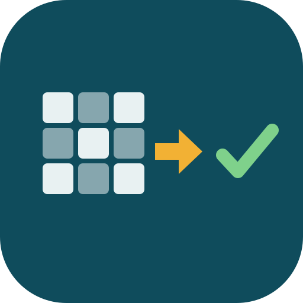
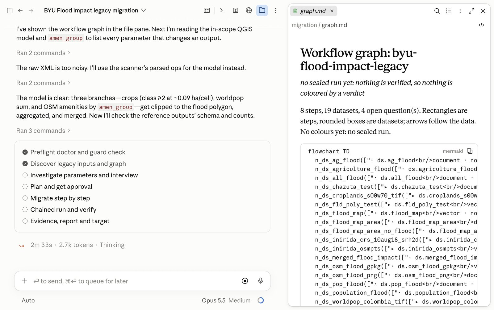
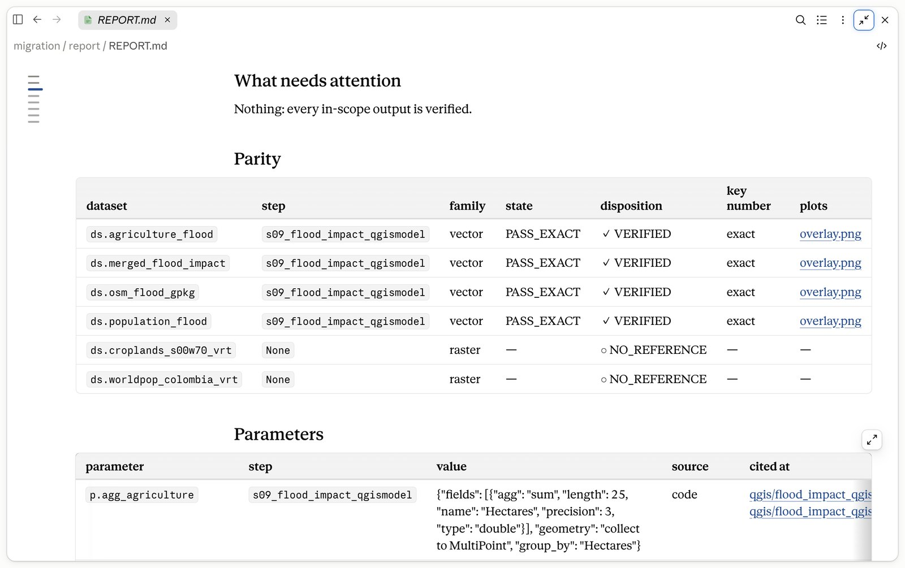

<p align="center"></p>

# axis-migrate

A Claude Code plugin that migrates a legacy desktop GIS project (QGIS projects and models, ArcPy or PyQGIS scripts, notebooks, Excel) into a reproducible Python codebase. It checks every step against the legacy run's own outputs, and a script computes the final status from the evidence. The agent can't claim one.



## Install

In Claude Code (desktop app Code tab or terminal):

```
/plugin marketplace add najahpokkiri/axis-migrate
/plugin install axis-migrate@axis-migrate-dev
```

Then restart or start a new session. `/axis-migrate:migrate` should appear in the slash-command list.

**Codex:**

```
codex plugin marketplace add najahpokkiri/axis-migrate --ref main
codex plugin add axis-migrate@axis-migrate-dev
```

Then trust the plugin's hooks once in `/hooks` and type `$axis-migrate:start` in a new chat. See [CODEX.md](axis-migrate/CODEX.md).

**Requirements:** macOS or Linux, and [`uv`](https://docs.astral.sh/uv/) on your PATH. On first use the plugin builds one pinned Python environment in `~/.cache/axis-migrate/`. On Linux, `strace` is needed for the strongest read ledger.

## Use

From the folder that holds your legacy project:

```
/axis-migrate:migrate ./my-legacy-project
```

Everything is written to `./migration/`. The legacy folder is never written to; the plugin's hooks refuse it.

## What it does

1. **Discover.** Reads the whole folder and draws the workflow graph: steps, datasets and how data flows.
2. **Interview.** Works out every parameter that changes an output from the files, with a citation for each. It asks only what the files can't answer, one question at a time.
3. **Plan.** Picks the workflow to migrate, sets the rest aside with reasons, and maps each legacy operation to open-source Python (geopandas, rasterio, GDAL, shapely). You approve the plan once.
4. **Run.** Writes one step at a time, runs it in a pinned environment, and compares every output with the legacy one. When a step doesn't match, it traces the cause.
5. **Report.** Writes `migration/report/` with the parity table, legacy and new maps overlaid, the parameters and their sources, and the status.



## The status

A script (`skills/report/ladder.py`) computes the status from the sealed evidence. The agent can only quote it.

| Status | Means |
|---|---|
| generated | Pipeline code exists, but no clean run is in the evidence yet. |
| sandbox-validated | Ran in the pinned environment under a read ledger. Some checks are unsigned, or the ledger is the weaker macOS kind. |
| reference-verified | Every compared output matches the legacy outputs exactly, or within a tolerance a person signed, on a full run from raw inputs. |
| target-ready | Reference-verified, plus a Databricks bundle that passed offline checks and a dry run. It is never deployed by the plugin. |

## Scope today

- **Reads:** QGIS projects (`.qgz`, `.qgs`) and models (`.model3`), Python scripts (PyQGIS, ArcPy, plain), Jupyter notebooks, Excel, CSV, rasters and vector files.
- **Partial:** ArcGIS Pro projects (`.aprx`, `.atbx`). They are parsed only in part and not yet validated on a real project.
- **Inventory only:** ModelBuilder `.tbx` and `.mxd`.
- **Target:** Databricks Asset Bundle, which is written and dry-run but never deployed. Other platforms stop at reference-verified.

## Privacy

Runs are local by default, and your data stays on your machine. An optional [E2B](https://e2b.dev) sandbox (bring your own key) gives Linux runs on a Mac. It always shows you the upload list first.

## More

- Full plugin guide: [axis-migrate/README.md](axis-migrate/README.md)
- Changelog: [axis-migrate/CHANGELOG.md](axis-migrate/CHANGELOG.md)
- Built by [Axis Spatial](https://axisspatial.com)

## Licence

Apache-2.0. See [LICENSE](LICENSE).
